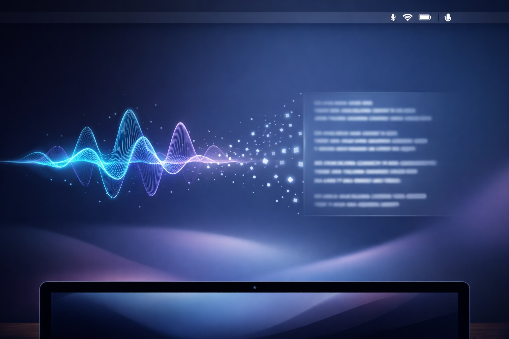

# 用說的，不用打的 — Saybit：macOS 上最聰明的語音輸入工具

凌晨兩點，我盯著螢幕上那份只寫了一半的技術文件，手腕傳來那熟悉的隱隱作痛。右手食指懸在鍵盤上方，遲遲不想落下——不是不知道要寫什麼，而是手實在累了。

這種感覺，你應該也不陌生吧？

身為一個每天寫程式、回訊息、寫文件的人，我的雙手大概比我的腦袋還要忙。有時候腦中的想法明明很清晰，手指卻跟不上思考的速度；有時候明明只是想快速回覆一則訊息，卻得在中英文輸入法之間切來切去。更別提那些開會後要整理的會議記錄——聽完就忘了一半，打字又打不完。

後來我開始想，如果說話就能變成文字，那該有多好？

不是那種講什麼就打什麼的「聽寫」，而是真正理解我想表達的意思，幫我整理好語句、加上標點、去掉那些「嗯」「啊」「那個」，最後直接貼到我正在使用的 App 裡。

這就是 Saybit 在做的事。

---

## Saybit 是什麼？

簡單來說，Saybit 是一個住在你 Mac 選單列（menu bar）的小幫手。它很安靜，平常就是個小麥克風圖示待在那裡，直到你按下快捷鍵叫它出來。

按下快捷鍵，開始說話。說完，Saybit 會把你的話送給 AI 處理——不只是轉成文字而已，還會幫你潤飾、調整格式、甚至根據你正在用的 App 來決定該用什麼語氣。處理完，文字就自動貼到你原本在打字的地方。

整個流程大概三到五秒。你甚至不用切換視窗、不用複製貼上、不用手動修改。

說實話，這改變了我工作的方式。

---

## 不只是轉錄，是「會思考的秘書」

市面上的語音輸入工具不少，但多數就是「聽到什麼打什麼」。你說「嗯...我覺得這個 feature 的 implementation 應該...啊不對，應該要改一下架構」，它就會原封不動打出來，包括那些「嗯」和「啊不對」。

Saybit 不一樣。

它背後接的是 LLM（大型語言模型），會理解你話語中的「意圖」，而不只是「字詞」。所以當你說「嗯那個明天下午三點跟 John 開會討論一下專案進度」，它會整理成「明天下午 3 點與 John 開會討論專案進度。」——乾淨、完整、可以直接用。

更厲害的是，它會看你現在在用什麼 App：

- 在 **Slack** 或 **LINE** 裡說話？它會用比較口語的方式輸出
- 在 **Gmail** 裡寫信？自動切換成比較正式的語氣
- 在 **VS Code** 或 **Cursor** 裡寫 code？它會進入開發者模式，懂你說的 camelCase 和 snake_case

這種「上下文感知」，是我用過其他語音工具都做不到的。

---

## 開發者的秘密武器：Vibe Coding

好，我承認我是個工程師，所以特別在意這個功能。

「Vibe Coding」這個詞最近在開發者圈子裡很紅——簡單說就是用語音跟 AI 編輯器對話寫程式。你打開 Cursor 或 Windsurf，對著麥克風描述你要什麼功能，AI 就會幫你生成程式碼。

這種工作流程下，語音輸入的品質變得超級重要。你說的每個字都會影響 AI 生成的結果。

當你在程式碼編輯器裡使用 Saybit，它會自動識別你在說程式相關的東西。比如：

- 你說「camel case user name」，它會打出 `userName`
- 你說「snake case max retries」，它會打出 `max_retries`
- 你說「npm install dash dash save dev typescript」，它會打出 `npm install --save-dev typescript`
- 你說技術名詞，它會正確拼寫：Kubernetes、PostgreSQL、Supabase、Vercel、Next.js

這對於要寫 commit message、code comment、或者跟 AI 編輯器對話都超級方便。

有一次深夜改 bug，我累到打字都會 typo，但腦袋還很清醒。我就開著 Saybit 直接用說的跟 Cursor 對話：「Generate a retry mechanism with exponential backoff for the API client」。它準確轉錄了每個單詞，Cursor 就生成了我要的程式碼。

配合 Smart Send 功能，說完話三秒後自動送出，整個流程完全不用碰鍵盤。

那一刻我覺得，這才是 Vibe Coding 該有的樣子。

---

## 支援多語言混著講

住在台灣，寫程式難免會中英文混用。我可能會說「這個 API endpoint 的 response 要加一個 error handling」，Saybit 會維持這種混搭風格，不會硬把英文翻成中文，也不會把中文音譯成奇怪的拼音。

它也支援日文，所以如果你工作上需要用到日文，說「この会議は来週に延期します」也沒問題。

對了，繁體中文的支援做得很好。不會莫名其妙跑出簡體字，這對台灣用戶來說很重要。

---

## 預覽模式：送出前再看一眼

有時候 AI 潤飾的結果不一定完全符合你的意思，或者你突然想改一個詞。Saybit 有個「預覽模式」，讓你在文字送出之前先看一眼，確認沒問題再按確認注入。

如果覺得不對，還可以點「重新生成」讓 AI 再想一次，或者直接取消。

這個功能在我寫重要郵件或訊息的時候特別有用。畢竟有些話說出去就收不回來了嘛。

---

## Smart Send：為 Vibe Coding 而生

這功能的設計初衷，其實是為了「Vibe Coding」。

什麼是 Vibe Coding？簡單說，就是用語音跟 AI 編輯器對話寫程式。你打開 Cursor 或 Windsurf，對著麥克風說「Generate a Python function that checks if a number is prime」，AI 就會幫你生成對應的程式碼。

這種工作流程下，說完話之後需要按 Enter 送出指令。Smart Send 就是自動幫你做這件事——文字注入完成後開始倒數（預設三秒），時間到自動按 Enter。

但如果你在倒數期間又開口說話，它會偵測到聲音然後自動取消送出。這設計很聰明：如果你還在說話，代表你可能還有話要補充或者想修改。所以它會等你講完再決定要不要送。

在 AI 編輯器裡，這讓「用說的寫程式」變成一個無縫的流程。在通訊軟體裡也一樣好用——說完話，等三秒，自動送出。

---

## 不只打字，還能建立行程

最近加的功能是行事曆和提醒事項整合。你可以說：

- 「幫我排明天下午三點的會議」
- 「提醒我下週五交報告」

Saybit 會解析你的話，自動建立 Calendar 事件或 Reminders 提醒。送出前一樣會讓你預覽確認。

這讓我少開了很多次行事曆 App，真的蠻方便的。

---

## 誰適合用 Saybit？

說了這麼多功能，到底誰最適合用這工具？

**程式設計師、工程師**
如果你每天要打大量的字，無論是 code、文件、還是跟同事溝通，Saybit 能讓你的輸入速度直接翻倍。而且開發者模式真的是為我們設計的。

**內容創作者、寫作者**
有時候寫作卡住不是因為沒靈感，而是打字太慢跟不上思緒。用說的把想法倒出來，再慢慢編輯，是很多作家推薦的技巧。Saybit 讓這個流程更順暢。

**多語言工作者**
如果你的工作需要在中英日之間切換，Saybit 的多語言支援能省下很多切換輸入法的時間。

**有 RSI 風險或手腕不適的人**
這可能是最重要的。研究顯示語音輸入可以減少高達 90% 的打字量，對於有重複性勞損（RSI）風險的人來說，這不只是效率工具，更是健康投資。

我自己就是因為手腕開始痛才認真研究語音輸入的。現在每天大概有 30-40% 的文字輸入是用說的，手腕狀況好多了。

---

## 為什麼不用 Typeless 或 Wispr Flow？

說到語音輸入工具，市面上最紅的大概就是 Typeless 和 Wispr Flow 了。我都用過，它們確實很好，但有幾個點讓我最後選擇自己做 Saybit。

**訂閱費用的問題**

Typeless 和 Wispr Flow 都是訂閱制，Pro 版大約每月 $12-15 美元。免費版有字數限制——Typeless 每週 4,000 字，Wispr Flow 每週 2,000 字。

對於重度使用者來說，這些額度很快就會用完。而且訂閱制意味著你得持續付費，一年下來也是不小的開支。

Saybit 的做法不同：你用自己的 API key。這意味著：
- **成本完全可控**：用多少付多少，不用了就不花錢
- **沒有字數限制**：只要你的 API 額度夠，想用多少就用多少
- **多供應商選擇**：OpenRouter、Groq、Together AI、甚至本地的 Ollama 都可以

實際算下來，如果你用 Groq 這種便宜又快的服務，成本可能只有訂閱制的十分之一。

**隱私的考量**

Wispr Flow 曾經因為隱私問題引發社群強烈反彈——它會每隔幾秒截取螢幕截圖，傳送到雲端處理。雖然後來改善了，但這件事讓我對雲端服務的信任度打了折扣。

Saybit 的所有設定和 API key 都存在本地的 Keychain，不會上傳到任何第三方伺服器。語音資料只會送到你選擇的 LLM 供應商，而且你可以選擇用 Ollama 這種完全本地的方案。

**功能的結合**

怎麼說呢，Typeless 的智慧編輯很強，Wispr Flow 的開發者模式很好用。Saybit 試圖把兩者的優點結合起來：
- 像 Typeless 一樣的智慧潤飾（去贅詞、自動標點、語調適配）
- 像 Wispr Flow 一樣的開發者模式（變數命名、CLI 指令解析）
- 再加上自己的特色（Smart Send、行事曆整合、預覽模式）

---

## 技術小細節（給好奇的人）

Saybit 支援兩種語音辨識引擎：

1. **Apple Speech**：系統內建，支援離線使用，反應快
2. **Whisper API**：OpenAI 的雲端服務，準確度更高，但需要網路

LLM 部分支援多個供應商：

| 供應商 | 特色 |
|--------|------|
| OpenRouter | 預設選擇，支援 100+ 模型（GPT-4、Claude、Gemini） |
| OpenAI | 直連 OpenAI API |
| Groq | 超低延遲，成本極低 |
| Together AI | 開源模型 |
| Ollama | 本地部署，完全離線，免 API Key |
| 自訂端點 | 任何 OpenAI 相容 API |

所有設定和 API key 都存在本地（Keychain），不會上傳到任何第三方伺服器。

---

## 開始使用

怎麼說呢，語音輸入這件事，真的是用過就回不去了。

一開始可能會有點不習慣——畢竟我們打字打了這麼多年。但給它一個禮拜的時間，你會發現自己開始「想」到什麼就「說」出來，而不是「想」到什麼要「打」出來。

這種轉變，某種程度上是解放了思考的頻寬。你不用再分心去按鍵盤，可以更專注在內容本身。

Saybit 的設計初衷很簡單：把 Typeless 的智慧編輯和 Wispr Flow 的開發者模式結合起來，然後讓你用自己的 API key，不用被訂閱制綁住。

成本低、隱私好、功能全。這是我想要的語音輸入工具，所以我做了它。

試試看用說的吧。你的手腕會感謝你的。

---

*Saybit 是一款 macOS 專屬的選單列應用程式，將語音輸入與 AI 智慧潤飾結合，支援 Vibe Coding 工作流程，讓說話變成打字的自然延伸。*
