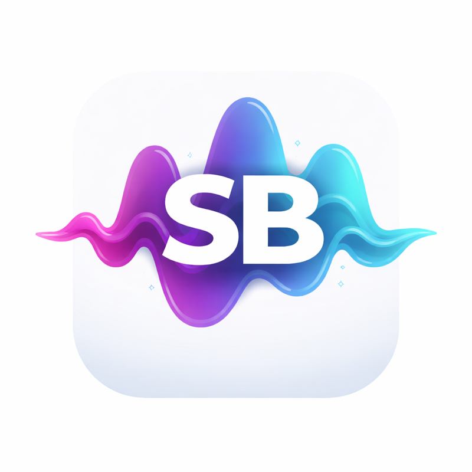

<p align="center">
  
</p>

<h1 align="center">Saybit</h1>

<p align="center">
  <strong>語音輸入工具</strong><br>
  按下快捷鍵說話，AI 即時潤稿後自動貼入任何應用程式。
</p>

<p align="center">
  
  
  
  
</p>

## 這個 repo 有兩個 app

| | `speakertpyer/` | `saybit-desktop/` |
|---|---|---|
| 技術 | Swift 6 + SwiftUI + AppKit | Tauri 2.0（Rust + React 19） |
| 平台 | macOS 15.2+ | macOS / Windows / Linux |
| Bundle ID | `com.bashcat.speakertpyer` | `com.oliver.saybit-desktop` |
| 定位 | 原生選單列 app，功能最完整 | 跨平台版，功能已對齊原生 |

兩者是**各自獨立的實作，不共用程式碼**，只共用產品概念。本文件先描述原生 macOS 版，跨平台版見[下方章節](#跨平台桌面版-saybit-desktop)。

## 功能特色

### 核心流程

```
快捷鍵 → 錄音 (STT) → LLM 潤稿 (streaming) → 自動貼入 (Cmd+V)
```

- **語音轉文字**：支援 Apple Speech (本地) 與 OpenAI Whisper API (雲端) 雙引擎
- **LLM 智能潤稿**：去除口頭禪、修正語法、自動標點、格式化清單
- **自動注入**：處理完成後透過模擬 Cmd+V 貼入目前焦點應用
- **Context Awareness**：自動偵測目前應用（Slack、Gmail、VS Code 等）調整語氣風格

### 語音辨識引擎

| 引擎 | 特性 | 適用場景 |
|------|------|---------|
| Apple Speech (本地) | 免費、即時轉錄、支援 on-device | 日常使用、離線環境 |
| Whisper API (雲端) | 辨識準確度高、支援多語言口音 | 專業術語、混合語言 |

### LLM 服務商

| 服務商 | 說明 |
|--------|------|
| OpenRouter | 預設，支援 100+ 模型 (GPT-4.1, Claude, Gemini) |
| OpenAI | 直連 OpenAI API |
| Groq | 超低延遲推理 |
| Together AI | 開源模型 |
| Ollama | 本地部署，完全離線，免 API Key |
| 自訂端點 | 任何 OpenAI 相容 API |

### Prompt 風格

- **Typeless**：通用模式，適合日常文書、聊天、筆記
- **Wispr Flow**：開發者模式，支援變數命名（camelCase/snake_case）、CLI 指令解析、技術術語修正

### 語調控制

| 語調 | 說明 | 適用情境 |
|------|------|---------|
| 自動 | 根據目前應用自動判斷 | 預設 |
| 正式 | 完整句式、敬語 | Email、文件 |
| 口語 | 自然對話 | 聊天、訊息 |
| 很口語 | 極簡、口語化 | LINE、Discord |

### 進階功能

#### 注入前預覽

開啟後，LLM 處理完成不會直接貼入，改為在浮動膠囊顯示預覽：

- **輸入** — 確認後貼入文字
- **重新生成** — 重新呼叫 LLM 處理
- **取消** — 放棄本次輸入

#### Smart Send

文字貼入後自動倒數，時間到自動按下 Enter 送出。倒數期間偵測到說話會自動取消。

#### Speak-to-Edit

先選取文字再按快捷鍵，說出指令即可操作選取的文字：

```
選取 "你好世界" → 說 "翻譯成日文" → 輸出 "こんにちは世界"
選取報告內容 → 說 "改成正式語氣" → 自動轉換
```

#### 語音技能 (Voice Skills)

自訂觸發詞與對應的 Prompt 指令。說出觸發詞時，系統會載入該指令引導 LLM 處理後續語音內容：

```
觸發詞「寫信」→ Prompt「請用正式商業書信格式撰寫，包含問候語與結尾敬語」
觸發詞「摘要」→ Prompt「請將以下內容整理為 3-5 條重點摘要」
```

#### 個人字典

為語音辨識容易出錯的詞彙設定偏好寫法，LLM 會自動替換：

```
openai → OpenAI
supabase → Supabase
```

### 快捷鍵模式

| 模式 | 操作方式 |
|------|---------|
| 按一下觸發 | 按快捷鍵開始錄音，靜音後自動停止 |
| 按住說話 | 按住快捷鍵錄音，放開後處理 |
| 雙擊觸發 | 雙擊快捷鍵開始/停止 |

預設快捷鍵：`⌥ Space` (Option + 空白鍵)

### Shortcuts 整合

支援 macOS Shortcuts，可串接自動化流程：

- **開始語音輸入** — 啟動錄音
- **停止語音輸入** — 停止錄音並處理
- **切換語音輸入** — 開始/停止切換
- **設定語氣風格** — 切換語調

## 系統需求（原生 macOS 版）

- macOS 15.2+
- 麥克風權限
- 語音辨識權限
- 輔助使用權限（快捷鍵 + 文字注入）

## 安裝與設定（原生 macOS 版）

### 1. 編譯

```bash
# 使用 Xcode 開啟專案
open speakertpyer.xcodeproj

# 或使用 xcodebuild
xcodebuild -scheme speakertpyer -configuration Debug build
```

### 2. 首次啟動

啟動後會進入設定精靈：

1. **授予權限** — 麥克風、語音辨識、輔助使用
2. **輸入 API Key** — 註冊 [OpenRouter](https://openrouter.ai/keys) 取得 API Key
3. **測試連線** — 確認 API Key 有效

### 3. 開始使用

1. 按下 `⌥ Space` 開始說話
2. 停頓 2 秒後自動結束錄音
3. 等待 LLM 處理（浮動膠囊顯示進度）
4. 文字自動貼入目前焦點的應用程式

## 架構（原生 macOS 版）

```
speakertpyer/
├── App/                          # 應用程式進入點
│   ├── SaybitApp.swift     # @main MenuBarExtra
│   ├── AppDelegate.swift         # 權限、快捷鍵、Onboarding
│   └── SaybitShortcuts.swift # Shortcuts 整合
│
├── Core/
│   ├── Pipeline/
│   │   └── VoicePipeline.swift   # 核心狀態機協調器
│   ├── SpeechRecognition/
│   │   ├── SpeechRecognizer.swift    # Apple Speech framework
│   │   ├── WhisperSTTClient.swift    # OpenAI Whisper API
│   │   ├── AudioLevelMonitor.swift   # Smart Send 語音偵測
│   │   ├── AudioSessionManager.swift # 輸入裝置管理
│   │   └── MicLevelTester.swift      # 設定頁音量測試
│   ├── LLM/
│   │   ├── OpenRouterClient.swift # Actor, streaming, 重試
│   │   ├── LLMProvider.swift      # 5 內建 + 自訂服務商
│   │   ├── SystemPrompts.swift    # Typeless / Wispr Flow
│   │   └── LLMPayload.swift      # 請求/回應結構
│   ├── Accessibility/
│   │   ├── TextInjector.swift     # Cmd+V / Enter 模擬
│   │   ├── TextExtractor.swift    # AX API 選取文字擷取
│   │   └── AccessibilityManager.swift
│   └── HotKey/
│       └── GlobalHotKeyManager.swift  # CGEvent tap
│
├── Models/
│   ├── TranscriptionSession.swift # @Observable 狀態機
│   ├── STTEngine.swift            # Apple Speech / Whisper
│   ├── ProcessingMode.swift       # 聽寫 / 指令 / 編輯
│   ├── ToneStyle.swift            # 自動 / 正式 / 口語
│   ├── PromptStyle.swift          # Typeless / Wispr Flow
│   ├── HotkeyTriggerMode.swift    # 按一下 / 按住 / 雙擊
│   └── AppContext.swift           # 應用偵測
│
├── Storage/
│   ├── SettingsStore.swift        # UserDefaults 設定
│   ├── Persistence.swift          # Core Data 控制器
│   ├── KeychainHelper.swift       # API Key 加密儲存
│   └── AppLogger.swift            # JSONL 日誌
│
└── UI/
    ├── Overlay/
    │   ├── OverlayView.swift      # 浮動膠囊 UI
    │   └── OverlayWindow.swift    # NSPanel 管理
    ├── Settings/                  # 分頁設定
    │   ├── SettingsView.swift
    │   ├── GeneralSettingsView.swift
    │   ├── APISettingsView.swift
    │   ├── PromptSettingsView.swift
    │   ├── HotKeySettingsView.swift
    │   └── DictionarySettingsView.swift
    ├── MenuBar/
    │   └── MenuBarView.swift
    ├── History/
    │   └── HistoryView.swift
    ├── Statistics/
    │   └── StatisticsView.swift
    └── Onboarding/
        └── OnboardingView.swift
```

### 狀態機

```
.idle → .recording → .processing → .done → .idle
                                  ↘ .previewing → .done → .idle
                         .done → .confirming(remaining) → .idle
                                  ↘ .error → .idle
```

### 資料儲存

| 資料類型 | 儲存方式 |
|---------|---------|
| 設定 | UserDefaults (`@Published` + `didSet`) |
| API Key | Keychain (per-provider) |
| 歷史紀錄 | Core Data (`TranscriptionRecord`) |
| 個人字典 | Core Data (`PersonalDictionaryEntry`) |
| 語音技能 | Core Data (`SnippetEntry`) |
| 日誌 | JSONL 檔案 (7 天自動清理) |

### 技術細節

- **無外部套件**：全部使用 Apple 系統框架
- **Concurrency**：`OpenRouterClient` 使用 Actor 確保線程安全
- **Streaming**：`AsyncThrowingStream` 處理 SSE 串流回應
- **重試機制**：指數退避 (1s → 2s → 4s) + 隨機抖動，最多 3 次
- **音訊處理**：Whisper 模式錄音轉 16kHz mono 16-bit PCM WAV
- **文字注入**：暫存剪貼簿 → 設定新內容 → 模擬 Cmd+V → 200ms 後恢復原剪貼簿

## 日誌

日誌儲存於：

```
~/Library/Application Support/Saybit/logs/
```

格式為 JSONL，包含 timestamp、level、category、message。7 天自動清理。

---

## 跨平台桌面版 (saybit-desktop)

Tauri 2.0 實作，可在 **macOS / Windows / Linux** 執行。功能已與原生 macOS 版對齊，兩處因平台限制有差異（見下方「與原生版的差異」）。

### 語音辨識引擎

| 引擎 | 平台 | 需要金鑰 | 特性 |
|------|------|---------|------|
| 串流辨識 | 全平台 | 是 | WebSocket 邊講邊出字，講完即有逐字稿。支援阿里雲百鍊（Fun-ASR / Qwen-ASR）與訊飛 RTASR |
| Apple 語音辨識 | 僅 macOS | 否 | 系統內建，免下載模型，可強制離線（音訊不出機器） |
| 本地 whisper.cpp | 全平台 | 否 | `large-v3-turbo` q5_0（約 574MB），完全離線 |
| 雲端 Whisper API | 全平台 | 是 | OpenAI `whisper-1` 或 Groq `whisper-large-v3` |

串流辨識的 WebSocket 跑在 Rust 端而非 webview —— 阿里雲的認證是 handshake 上的 `Authorization` header，瀏覽器的 WebSocket API 設不了自訂 header。連線失敗會自動退回雲端 Whisper，不會讓錄音整個失敗。

> ⚠️ 阿里雲與訊飛的協定是依官方文件實作，尚未在真實帳號上驗證。設定畫面提供「測試連線」按鈕先行確認憑證與端點。

### 文字注入

| 模式 | 說明 |
|------|------|
| 貼上 | 寫剪貼簿 + Cmd/Ctrl+V，最快；0.5 秒後自動還原原本的剪貼簿內容 |
| 逐字輸入 | 模擬鍵盤逐字打出，給不吃貼上的視窗 |
| 取代選取 | 先送 Backspace 清掉選取內容再貼上 |

### 音訊處理鏈

```
getUserMedia → 高通 80Hz → 低通 8kHz → analyser + AudioWorklet(PCM 擷取)
                                          ↓
                            預錄環形緩衝（保留按下快捷鍵之前的音訊）
```

`AudioContext` 直接開在 16kHz，由瀏覽器自己的重採樣器降頻，批次與串流兩條路都不必手動重採樣。帶通濾波的 Butterworth Q 值與原生版 `VoiceBandpassFilter` 一致。

### 安全性

API 金鑰存放於**系統金鑰庫**（macOS Keychain / Windows Credential Manager / Linux Secret Service），不寫進設定檔。舊版明文存在 localStorage 的金鑰會在首次啟動時自動搬遷並清除。

### 開發

```bash
cd saybit-desktop
npm install
npx tauri dev              # 開發模式（HMR）

npx tsc --noEmit           # 前端型別檢查
cd src-tauri && cargo clippy --all-targets -- -D warnings

npm run tauri build        # 產出 .app / .dmg / .msi / .AppImage
```

### 架構

```
saybit-desktop/
├── src/
│   ├── hooks/useVoicePipeline.ts   # 狀態機 + 音訊 + STT + LLM 協調
│   ├── services/
│   │   ├── audioChain.ts           # 麥克風擷取鏈（濾波 / 預錄 / PCM）
│   │   ├── streamingStt.ts         # 串流辨識前端介面
│   │   ├── systemPrompts.ts        # Prompt 全集（移植自原生 SystemPrompts.swift）
│   │   ├── appContext.ts           # 前景 App 辨識與分類
│   │   ├── contextRules.ts         # per-app 語氣規則
│   │   ├── providers.ts            # LLM 服務商 + 模型清單查詢
│   │   ├── pricing.ts              # Token 成本估算
│   │   ├── sttArtifacts.ts         # 靜音閘 + whisper 幻覺過濾
│   │   ├── settings.ts             # 設定模型 + 金鑰庫存取
│   │   └── l10n.ts                 # 四語系（繁中/簡中/英/日）
│   └── views/                      # 設定分頁、膠囊、導引、教學
│
└── src-tauri/src/
    ├── platform.rs        # 前景視窗查詢、選取文字擷取
    ├── injection.rs       # 三種文字注入模式
    ├── streaming_stt.rs   # WebSocket 串流辨識（阿里雲 / 訊飛）
    ├── secure_store.rs    # 系統金鑰庫
    ├── apple_speech.rs    # SFSpeechRecognizer（macOS）
    ├── eventkit.rs        # 行事曆 / 提醒（macOS）
    └── local_stt.rs       # whisper.cpp
```

### 與原生版的差異

兩處因平台限制無法完全對齊：

1. **選取文字擷取**走剪貼簿而非 AX API（Tauri 沒有等價 API）。因此**終端機視窗會自動跳過**，避免沒有選取時 Ctrl+C 變成 SIGINT 中斷使用者正在跑的程式。
2. **剪貼簿備份僅限文字**。Tauri 的剪貼簿外掛無法像原生 `ClipboardBackup.swift` 那樣快照所有 pasteboard 型別，因此在複製圖片後注入文字，圖片剪貼簿內容會遺失。

---

## 授權

MIT License
